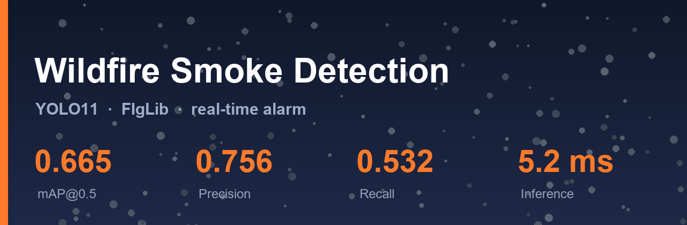

<div align="center">



**基于 YOLO11 的森林火灾烟雾检测与时序预警原型**

[](https://www.python.org/)
[](https://pytorch.org/)
[](https://docs.ultralytics.com/)
[](LICENSE)
[]()

*火情前全程静默（quiet）→ 烟羽出现连续命中 → 触发告警（滑动窗口投票，3 帧内 ≥2 帧命中）。
效果演示动图与逐帧案例见 [docs/训练评估报告.md](docs/训练评估报告.md) 与 [docs/技术决策复盘.md](docs/技术决策复盘.md)；
因 FIgLib 数据授权限制（CC BY-NC-ND），本仓库不含任何原始摄像头画面。*

</div>

---

## 效果一览

| 指标（验证集 112 张 / 62 框，conf = 0.25） | v3 数据优化 | **v5 +伪标签（最新）** |
|---|---|---|
| mAP@0.5 | 0.665 | **0.666** |
| mAP@0.5:0.95 | 0.298 | 0.290 |
| Precision | 0.756 | **0.835** |
| Recall | 0.532 | **0.597** |
| 单帧推理（960px, RTX 4060 Laptop） | 5.2 ms ≈ 190 FPS | 5.2 ms ≈ 190 FPS |
| 模型体积 | 5.2 MB | 5.2 MB |
| 时序告警 | 火情前零误报；烟羽出现后约 22~24 分钟报警 | 火情前零误报；远距火情序列告警再提前 10 分钟 |

> **定位**：基于公开数据集的算法验证与原型系统，**无真实外设 / 边缘硬件**。
> 完整实验过程、消融与失败案例分析见 [docs/训练评估报告.md](docs/训练评估报告.md)；
> 哪些做法有效、哪些被证伪、环境上费过哪些周折、离可上线还差多少，见 **[docs/技术决策复盘.md](docs/技术决策复盘.md)**。

## 它能做什么 / 不能做什么

**能**：烟羽发展起来之后（目标 ≥ 40px），框得又准又稳；火情前段背景帧零误报。

**不能**：起火瞬间只有 20px 的极小烟柱——单帧 RGB 的信息量天生不够（量化数据见下文 EDA）。这与 FIgLib 原论文 SmokeyNet 选择光流 + 多帧时序的结论一致。

> 实测案例（图示因数据授权不入库，复现后由 `scripts/preview_dataset.py` / `scripts/evaluate.py` 本地生成）：
> 同一火情序列，T+0s 时 GT 框仅约 20px（地平线处肉眼几乎不可见）→ 漏检；
> T+840s 烟羽长成 → 同一模型精准命中（P-R 双框基本重合）。
> 时序告警曲线：mobo-c 序列 T+1440s 报警、iqeye 序列 T+1320s 报警，火前零误报。

## 数据量化分析（决定训练策略的依据）

训练前先做了标注 EDA，两个结论直接改写了训练方案：

<div align="center">

</div>

1. **目标相对宽度中位数只有 6.3%**（最小 24px）。若用 640 训练，最小目标只剩约 8px，基本不可见 → 这决定了 imgsz 必须加大，且**源图不能先压缩**。
2. **COCO 尺寸分类：small 13% / medium 42% / large 45%**，烟雾集中在地平线附近（位置热力图）、长宽比中位 1.82（横向烟带）。

## 实验对比：数据预处理才是关键

| # | 源图 | imgsz | 增强 | mAP@0.5 | mAP@0.5:0.95 | P | R |
|---|------|-------|------|---------|--------------|------|------|
| v1 | 压缩 1280 / q90 | 640 | 默认 | 0.630 | 0.275 | 0.818 | 0.436 |
| v2 | 压缩 1280 / q90 | 800 | 默认 | 0.546 | 0.216 | 0.740 | 0.484 |
| v3 | 原始 2048 / q95 | 960 | +copy_paste 等 | 0.665 | 0.298 | 0.756 | 0.532 |
| **v5** | 原始 2048 / q95 | 960 | **+ 伪标签回灌**（156 框 / 60 序列） | **0.666** | 0.290 | **0.835** | **0.597** |

三个和预期不符的结果（详见报告）：

- v2 说明**单提 imgsz 无效**——源图已被压缩，信息在进模型前就丢了；
- v3 说明**高清源图 + 高 imgsz + 小目标增强**三者叠加才有效：Recall +22%；
- v5 说明**伪标签提高了精度，没有提高召回**：P +19pp，但 small 目标盲区被教师原样复制（0.6% vs 14.6%），R 的上限仍在数据手里。

## 目录结构

```
forest_fire_smoke_detection/
├── configs/                 # YAML 配置（数据集 / 训练 / 推理 / 服务）
├── src/ffsd/
│   ├── core/                # 配置、日志、异常
│   ├── data/                # 标注转换与校验
│   ├── models/              # Detector 抽象 + YOLO 实现
│   ├── inference/           # 推理引擎、视频读取、绘制
│   ├── alert/               # 时序决策（纯逻辑可单测）+ 告警通道
│   └── service/             # FastAPI 服务
├── scripts/                 # CLI：analyze / prepare / pseudo_label / train / evaluate / demo / gif
├── tests/                   # pytest
├── docs/                    # 训练评估报告 + 全部图表
├── data/  models/  results/ # 数据与产物（不入库）
└── pyproject.toml
```

## 快速开始

### 1. 环境

```bash
python -m venv .venv
.\.venv\Scripts\Activate.ps1        # Windows
pip config set global.index-url https://pypi.tuna.tsinghua.edu.cn/simple
pip install -r requirements.txt
```

> GPU 训练需要 CUDA 版 torch。**PyPI 的 Windows torch 是 CPU 版**，装完
> `torch.cuda.is_available()` 仍是 False。国内装法：
>
> ```powershell
> pip install --index-url https://mirrors.aliyun.com/pytorch-wheels/cu121 `
>             --extra-index-url https://mirrors.aliyun.com/pypi/simple/ `
>             torch==2.4.1+cu121 torchvision==0.19.1+cu121
> ```

### 2. 预训练权重

```powershell
# 放项目根目录！ultralytics 的 AMP 自检会在这里找，否则卡在联网下载
curl.exe -L -4 -o yolo11n.pt `
  "https://ghfast.top/https://github.com/ultralytics/assets/releases/download/v8.3.0/yolo11n.pt"
```

### 3. 数据（FIgLib 官方标注，一条命令）

```bash
python scripts/analyze_dataset.py          # 先看 EDA，理解数据
python scripts/prepare_figlib.py           # 下载标注+图片，统一转 YOLO 格式
python scripts/preview_dataset.py          # 画框校验，确认坐标没转错
```

脚本自动完成：拉官方 bbox CSV → 下载图片 → 用文件名里的时间偏移**自动采集火前负样本** →
CSV 绝对坐标转 YOLO 归一化格式 → 按火情序列 + 相机型号分层划分。

### 4. 训练与评估

```bash
python scripts/train.py --config configs/train_figlib_opt.yaml   # 约 27 分钟 / 80 epoch
python scripts/train.py --config configs/train_figlib_opt.yaml --resume   # 断点续训
python scripts/evaluate.py --weights models/best.pt --data data/yolo --out results/eval
python scripts/demo_sequence.py --weights models/best.pt --seq 20160718_FIRE_mw-e-mobo-c
python scripts/make_gif.py --weights models/best.pt --seq 20160718_FIRE_mw-e-mobo-c
```

### 5. 伪标签半监督（v5，进阶）

FIgLib 有 525 个序列但只有 9 个带标注。流水线 `scripts/pseudo_label.py` 用现有模型
给未标注序列打标并回灌（probe 筛序列 → 采样下载 → 一次推理 → 阈值+防幻觉筛选 →
分布审计 → 合并，六个阶段均可单独重跑）：

```bash
python scripts/pseudo_label.py probe --teacher models/best.pt      # 先确认哪些序列真有可见烟
python scripts/pseudo_label.py collect --from-probe data/pseudo/probe.csv --probe-limit 60
python scripts/pseudo_label.py infer --teacher models/best.pt
python scripts/pseudo_label.py select --conf 0.35 --min-seq-hits 2
python scripts/pseudo_label.py audit                               # 伪标签 vs GT 尺寸分布
python scripts/pseudo_label.py merge                               # val 始终只含真标注
python scripts/train.py --config configs/train_figlib_pseudo.yaml  # 从 v3 权重自训练
```

为什么先 probe：**"未标注序列"不等于"画面里有可见烟"**——实测 516 个未标注序列里
只有 18% 在探针帧上有反应，其余连人眼都看不到烟。跳过这一步会让伪标签被大量
"正确地什么都没检出"的帧稀释。已知的代价：伪标签继承教师的小目标盲区
（small 占比 0.6% vs GT 14.6%），详见报告 4.6 节。

### 6. 服务

```bash
python scripts/serve.py --config configs/app.yaml
# http://localhost:8000/docs
```

## 架构

```
scripts/  →  service/  →  inference/ + alert/  →  models/  →  data/  →  core/
```

- `models/base.py` 定义 `Detector` 抽象，YOLO 只是实现之一，换后端只改一个文件
- `alert/decision.py` 纯逻辑（滑窗投票），无摄像头/GPU 依赖，pytest 全覆盖
- 配置外置 `configs/*.yaml`，pydantic 启动即校验；训练脚本前置校验 CUDA，缺环境直接报错不空跑

## 数据来源与授权

本仓库**不包含任何原始数据集或摄像头画面**（FIgLib 为 CC BY-NC-ND 4.0，禁止再分发与演绎），全部通过脚本按需拉取；
`docs/images/` 内均为本项目自绘的统计图表（训练曲线、PR 曲线、混淆矩阵、标注 EDA），不含任何影像帧。

- **烟雾数据**：HPWREN FIgLib — Data courtesy of HPWREN, UC San Diego (<https://www.hpwren.ucsd.edu/>)
- 引用：Dewangan, A., et al. (2022). *FIgLib & SmokeyNet: Dataset and Deep Learning Model for Real-Time Wildland Fire Smoke Detection*. Remote Sensing, 14(4), 1007.
- 免责声明：HPWREN data are not intended to be used as a decision-making tool.

## License

**AGPL-3.0**（因依赖 Ultralytics YOLO 的 AGPL-3.0）。闭源商用需购买 Ultralytics 商业授权，或替换宽松授权后端并重训模型。详见 [LICENSE](LICENSE)。

## 致谢

- [Ultralytics YOLO11](https://github.com/ultralytics/ultralytics)
- [HPWREN / UC San Diego](https://www.hpwren.ucsd.edu/)
