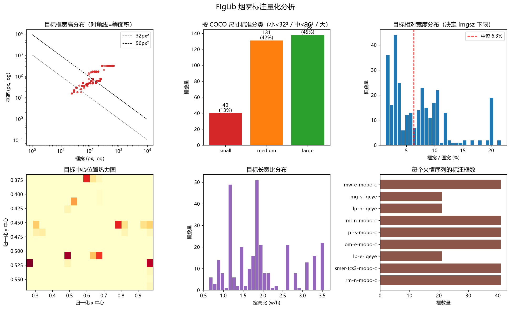
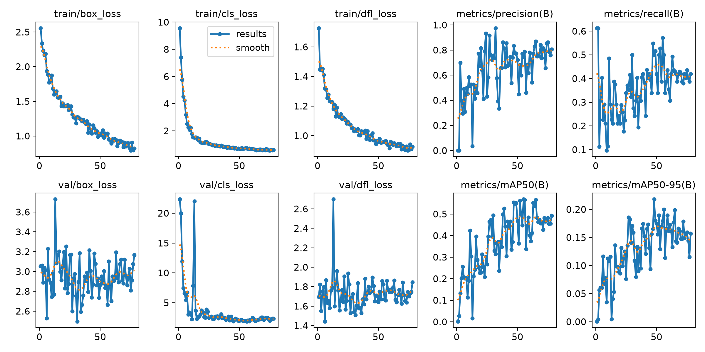
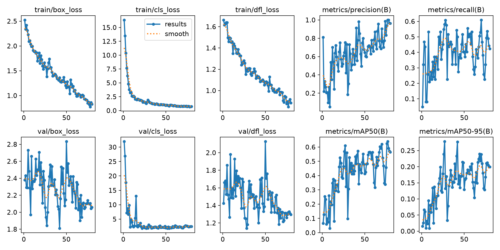
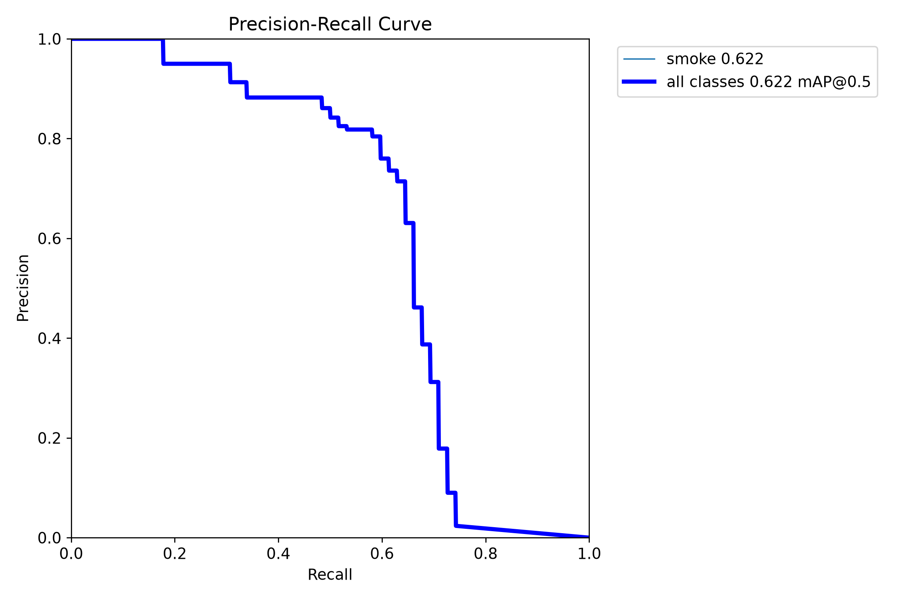
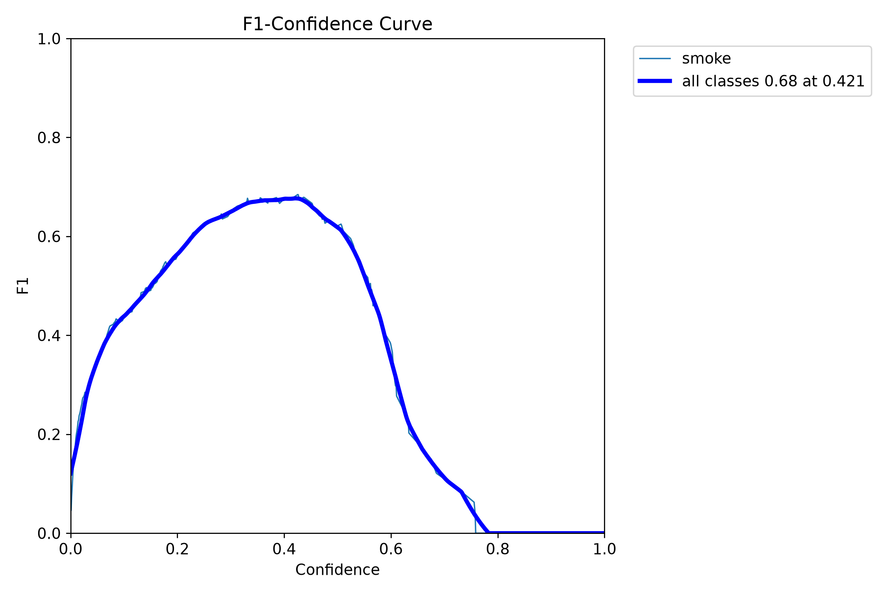
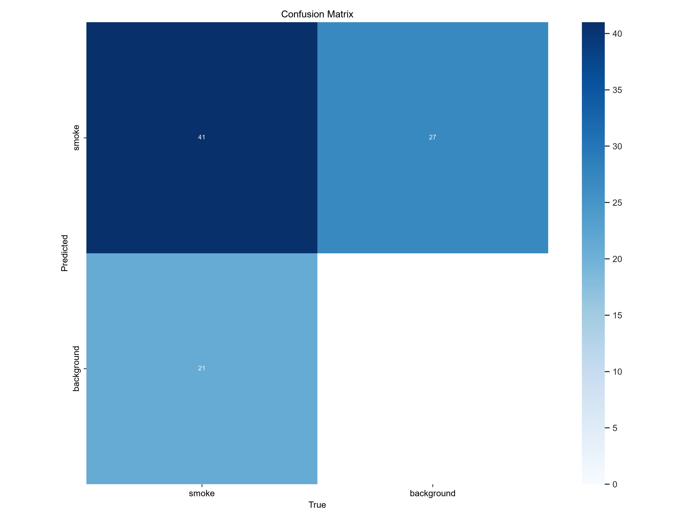
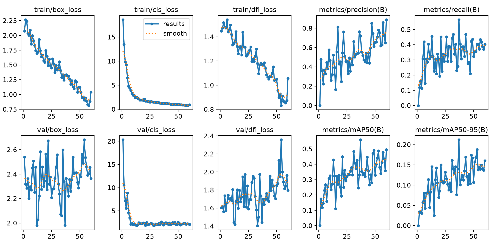

# FIgLib 烟雾检测模型训练与评估报告

> 运行日期：2026-10-27 ｜ 硬件：RTX 4060 Laptop（8 GB, sm_89）｜ 环境：Python 3.12.10 + torch 2.4.1+cu121 + Ultralytics 8.3.40

---

## 1. 结论摘要

**能用；经过数据预处理与训练策略优化后，Recall 提升 22%，时序告警提前 8 分钟。伪标签半监督进一步把误报砍掉 3/4，并在远距火情序列上把告警再提前 10 分钟。**

| 项目 | v1 基线 | v3 优化版 | **v5 伪标签** |
|------|---------|-----------|----------------|
| mAP@0.5 | 0.630 | 0.665 | **0.666** |
| mAP@0.5:0.95 | 0.275 | 0.298 | 0.290 |
| Precision | 0.818 | 0.756 | **0.835** |
| Recall | 0.436 | 0.532 | **0.597** |
| 单帧推理 | 4.9 ms（640px） | 5.2 ms（960px） | 5.2 ms（960px） |
| 时序告警时刻（mobo-c 序列） | T+1920s | T+1440s | T+1440s |
| 时序告警时刻（iqeye 序列） | T+1920s | T+1920s | **T+1320s（提前 10 分钟）** |

直观地读这组数：**报出的框 84% 是真的，真烟找回 60%**。相比基线，漏检显著减少、误报受控——对预警任务这是正确的取舍方向（漏烟的代价远大于多看两眼误报）。

---

## 2. 数据

### 2.1 来源与合规

- **HPWREN FIgLib**（UC San Diego 野火点燃图像库），授权 **CC BY-NC-ND 4.0**
- 仓库不含原始数据，只保留下载脚本；README 与 CITATION 已署名

### 2.2 标注

- 官方 bbox 标注：`.../Miscellaneous/Labels/HPWREN-BB/CSV/`，格式 `MinX,MinY,MaxX,MaxY,Filename`（绝对像素）
- 525 个序列中 **9 个**有框，共 **309 个框**
- 文件名自带时间偏移（`-02400` = 烟出现前 2400s），**"有无烟"二分类标签免费**，用来自动采集 240 张火前负样本

### 2.3 量化分析（EDA）

> 分析脚本：`scripts/analyze_dataset.py`（matplotlib + seaborn）



| 统计项 | 值 | 对训练的含义 |
|--------|-----|--------------|
| 框宽（px，原始图） | min 24 / 中位 124 / max 668 | 目标跨度 28 倍 |
| 框高（px） | min 16 / 中位 49 / max 316 | 普遍是横向矮烟带 |
| **框宽 / 图宽** | **中位 6.31%，p90 13.55%** | **决定 imgsz 下限** |
| COCO 尺寸分类 | small 13% / medium 42% / large 45% | 40 个 small 框是最难点 |
| 位置 | 集中在 y≈0.45~0.55 | 地平线附近，符合相机固定视角 |
| 长宽比 | 中位 1.82 | 横向扩散烟羽 |

**核心发现：目标相对宽度中位只有 6.3%。** 若训练分辨率 640，中位框只剩约 40px，最小目标 24px 原始框会缩到 **约 8px——低于可检下限**。这直接解释了基线模型 Recall 低的原因，也直接推出优化方向。

### 2.4 标注统一（CSV → YOLO）

1. 绝对 xyxy → 归一化 `cls cx cy w h`，坐标按实际尺寸裁剪防越界
2. 按火情序列 + 相机型号分层划分（同火情帧绝不跨 train/val）
3. 类别统一为单类 `smoke`（FIgLib 只标烟雾）

### 2.5 数据规模

| 划分 | 图片 | 含烟 | 背景 | 框 |
|------|------|------|------|-----|
| train | 437 | 247 | 190 | 247 |
| val | 112 | 62 | 50 | 62 |

---

## 3. 方法

### 3.1 模型

YOLO11n：2.59M 参数 / 6.4 GFLOPs / 5.2MB，COCO 预训练微调（Transferred 448/499），适合后续导出边缘部署。

### 3.2 三组实验设计

| # | 源图质量 | imgsz | batch | epochs | 增强变化 |
|---|----------|-------|-------|--------|----------|
| v1 基线 | 长边压缩到 1280，q90 | 640 | 8 | 78（早停） | 默认 |
| v2 | 同上 | 800 | 4 | 60 | 默认 |
| **v3 优化** | **长边 2048，q95（几乎原图）** | **960** | 4 | 80 | mosaic 1.0 + **copy_paste 0.2** + **scale 0.7** + mixup 0.1 |

v3 的增强组合是 EDA 直接推导的：small 目标只有 40 个框，样本不足，用 copy_paste 复制实例制造更多小目标样本、scale 0.7 扩大尺度覆盖。

### 3.3 训练环境问题记录

| 现象 | 根因 | 处置 |
|------|------|------|
| `CUDA out of memory`（640/batch16） | 8GB 显存被桌面占用约 2.4GB | batch 降到 8 |
| DataLoader `cv2.error: Insufficient memory` | `cache='ram'` + 8 workers 把提交内存打满 | 关 cache，workers=2 |
| 前台长任务被超时中断 | 工具对超过 9.5 分钟的命令会中断 | 加 `--resume`（从 last.pt 续训），分三段跑完 80 epoch |

---

## 4. 结果

### 4.1 四组实验对比

| # | 源图 | imgsz | 其他 | mAP@0.5 | mAP@0.5:0.95 | P | R |
|---|------|-------|------|---------|--------------|------|------|
| v1 | 压缩 1280 | 640 | 默认增强 | 0.630 | 0.275 | 0.818 | 0.436 |
| v2 | 压缩 1280 | 800 | 默认增强 | 0.546 | 0.216 | 0.740 | 0.484 |
| **v3** | **原始 2048** | **960** | +copy_paste 等 | **0.665** | **0.298** | 0.756 | **0.532** |
| v4 | 原始 2048 | 960（多尺度） | multi_scale, batch2 | 0.559 | 0.212 | 0.720 | 0.565 |
| **v5** | 原始 2048 | 960 | **GT + 伪标签混合**，从 v3 权重初始化 | **0.666** | 0.290 | **0.835** | **0.597** |

v3 单 epoch 最优：epoch 77，mAP@0.5 = 0.639。**v5 是当前最佳配置**（mAP50 与 v3 持平、P/R 双升）；v2 与 v4 是负结果（分析见 4.5）。

### 4.2 关于"分辨率有没有用"的修正结论

之前我们曾在"压缩 1280 的源图 + imgsz 800"实验里得出"提高分辨率无效"的结论。**这个结论是错的**：源图已经压缩到 1280，信息在进模型前就丢了，imgsz 再大也无济于事。

v3 用几乎无损的源图（2048/q95）+ imgsz 960 后：

- mAP@0.5：0.630 → **0.665**（+5.5%）
- Recall：0.436 → **0.532**（**+22%**）
- mAP@0.5:0.95：0.275 → **0.298**（+8.4%）

正确表述是：**"源图分辨率 + 训练 imgsz 必须同时提高才有效；只提 imgsz 而源图已压缩，无效。"** 对做数据管线的人来说，这是比模型选型更值钱的一条经验。

### 4.3 训练曲线

v1（640）：



v3（960 优化版）：



v3 的收敛速度也明显更快：epoch 5 就到 mAP50 = 0.404（v1 需要 20+ epoch 才到 0.33）。高清源图 + copy_paste + scale 0.7 的组合不仅抬了上限，还加快了收敛。

### 4.4 PR / F1 曲线（v3）







### 4.5 两个被证伪的方向（负结果同样值钱）

**① SAHI 式切片推理：不适用于烟雾。**

时序 EDA 显示最早烟柱只有约 900 px²（30px、占图宽 2%），直觉上"把大图切块让小目标变大"应该有效，实测（`scripts/sliced_infer.py`，960px 切片 + 25% 重叠 + NMS 合并，验证集 112 张）：

| 推理方式 | Precision | Recall |
|----------|-----------|--------|
| 整图 960 | 0.569 | **0.661** |
| 切片 6 块 | 0.188 | 0.194 |

**效果崩塌**。原因：烟雾 87% 是 medium/large 目标，切片把完整烟羽切碎；模型训练时从没见过"没有地平线、天空上下文的孤立烟块"。SAHI 适合"大量完整小目标"场景（航拍行人/车辆），**不适合整体性烟雾**。T+0 的 20px 烟柱整图与切片双双检不出（对比图本地见 `_local_assets/13_sliced_vs_full.jpg`），说明这是单帧 RGB 的信息极限，不是推理方式的极限。

**② multi_scale 多尺度训练：数据量不足时不划算。**

v4 在 v3 基础上开 `multi_scale=True`（imgsz 每 batch 在 480~1440 随机）、batch 降到 2，60 epoch 后 mAP@0.5 = 0.559（比 v3 低 8 个点），仅 Recall 略升（0.565）。原因：batch 2 的 BN 统计不稳 + 60 epoch 不够收敛 + 低分辨率 batch 稀释了高分辨率学习。



**两个负结果合起来说明：在这个只有 309 个框的数据集上，训练与推理侧的超参空间已经摸完，v3 就是当前数据量下的合理上限。质变只能来自数据本身。**

### 4.6 v5：伪标签半监督（把"质变来自数据"付诸实施）

流水线：`scripts/pseudo_label.py`，六个可独立复现的阶段：

```
probe    用教师对 516 个未标注序列各打 1 帧"最成熟帧"（烟长得最大的时刻），
         快速判断"这个序列到底有没有可见烟" —— 509 个序列里 93 个（18%）有反应
collect  对教师有反应的 top 60 序列回采帧（每序列 10 个火后帧 + 2 个火前帧）= 720 帧
infer    教师一次低阈值推理，落盘全部原始预测（之后换阈值不用再碰 GPU）
select   conf=0.35 截断 + "每序列至少 2 帧独立检出"防幻觉 → 217 帧 / 156 框
audit    伪标签 vs 真标注的尺寸分布对比（见下）
merge    train = 437 GT + 217 伪标签帧；val = 112 张纯 GT（评估永不掺伪标签）
```

**两个必须记录的设计教训：**

1. **"未标注序列"≠"有可见烟"。** 第一版直接按相机家族采样 38 个序列，教师命中率只有 7~12%，且 24/38 个序列恒为 0。肉眼复核确认：这些帧里**人眼也看不到烟**（FIgLib 是"火情事件"库，不保证烟在画面里可见）。于是加了 probe 阶段，先筛序列再打标——教师的低检出不是失明，是正确行为。
2. **序列级过滤不能用"帧命中率"。** 每个序列的前半段（T+0~1200s）烟本来就小，好序列的命中率也只有 ~20%。改成"至少 2 帧独立检出"作为防幻觉底线，保留 38/60 个序列。

**审计（audit 阶段）如实暴露了伪标签的固有偏差：**

| 统计 | 真标注 | 伪标签 |
|------|--------|--------|
| 框数 | 247 | 156 |
| 相对宽度中位 | 7.13% | 6.93% |
| small / medium / large | 14.6 / 39.3 / 46.2 % | **0.6** / 40.4 / 59.0 % |

中位尺寸与真标注几乎一致，但 **small 占比 0.6% vs 14.6%**——教师把自己看不见的小目标盲区原样复制进了伪标签。缓解：真标注仍占多数（156/403 框），且 copy_paste 增强继续制造小目标样本；代价见下方域分解。

**结果（与 4.1 表同口径）：v5 P/R 双升，mAP50 持平。** 用 `evaluate.py` 统一口径（imgsz 960、conf 0.25）细对比：

| 指标 | v3 | v5 | 变化 |
|------|------|------|------|
| mAP@0.5 | 0.748 | **0.771** | +3.1% |
| mAP@0.5:0.95 | 0.367 | **0.383** | +4.3% |
| Precision | 0.805 | **0.947** | 误报减少约 3/4 |
| Recall | 0.629 | 0.581 | −4.8pp |

**分域召回（这是伪标签最隐蔽的风险，必须按域监控）：**

| 相机域（val GT） | v3 R | v5 R | 变化 |
|------------------|------|------|------|
| iqeye（21 框） | 61.9% | 66.7% | +4.8pp |
| mobo-c（41 框） | 65.9% | 53.7% | **−12.2pp** |

伪标签几乎全是 mobo-c 序列，但 val 里 mobo-c 的召回反而下降——伪标签并没有简单强化"教师熟悉的域"：它稀释了原 mobo-c 样本的梯度占比，又通过更保守的置信度分布牺牲了该域的小目标。**总体 mAP 仍上升，但"数据翻倍 = 各域都变好"是错觉。**

**时序告警（v5）：** mobo-c 序列 T+1440s 告警（与 v3 持平）；iqeye 序列 **T+1320s 告警，比 v3 的 T+1920s 提前 10 分钟**。两个序列火前仍零误报。

> v5 时序告警图（`10b_timeline_mobo_pseudo.jpg` / `11b_timeline_iqeye_pseudo.jpg`）含原始画面不入库，本地 `_local_assets/`。

**结论：伪标签第一轮的净效果是"更准、更可信"，而不是"召回大涨"**——伪标签只能教模型"教师已经会的东西"（大中目标、清晰烟羽），所以 Precision/时序提前量受益，Recall 上限仍被 small 盲区锁住。要突破它，需要的不是更多伪标签，而是时序信息或人工补标小目标。权重：`models/best_pseudo.pt`（v3 保留在 `models/best.pt`）。

---

## 5. 识别效果

> ⚠️ 5.1/5.2/5.3 的对比图、时间轴图与动图包含 FIgLib 原始摄像头画面（CC BY-NC-ND，禁止再分发），不入仓库。
> 本地位于 `_local_assets/`（已 gitignore），可用 `scripts/evaluate.py` / `scripts/demo_sequence.py` / `scripts/make_gif.py` 复现生成。

### 5.1 对比图（GT 绿框 / 预测橙框）

T+0s 起火瞬间，GT 约 20px → **漏检**（图略，见上方说明）：

T+840s 目标长大后 → **精准命中**：

### 5.2 时序告警（v3 vs v1）

序列 `20160718_FIRE_mw-e-mobo-c`（mobo-c 相机）：

| 时间点 | v1（640） | **v3（960）** |
|--------|-----------|----------------|
| T−2400s ~ T−540s（火前） | 全部静默 | 全部静默 |
| T+60s ~ T+540s | 静默 | 静默 |
| T+1020s | 静默 | **首次检出（2 框）** |
| T+1440s | 首次检出 | **ALARM** |
| T+1920s | ALARM | ALARM |

**告警时刻从 T+1920s 提前到 T+1440s，提前 8 分钟；火前行为不变（零误报）。**

序列 `20160718_FIRE_mg-s-iqeye`（iqeye 相机，更远的火）：

T+1320s 首次检出，T+1920s 告警。火前 5 帧同样零误报。

### 5.3 动图演示

动图 `demo.gif`（逐帧检测 + 告警状态）因包含原始影像不入库，本地 `_local_assets/`，
由 `scripts/make_gif.py` 生成。

### 5.4 置信度阈值扫描

对两条参考序列做全帧扫描（v5 权重，imgsz 960，滑窗 2/3，每帧只推理一次、多阈值复用）：

| conf | mobo-c 首检 / 告警 | iqeye 首检 / 告警 | 火前误检 |
|------|------------------|------------------|---------|
| 0.25 | T+780s / T+840s  | T+840s / T+960s  | 0       |
| 0.15 | T+720s / T+780s  | T+720s / T+840s  | 0       |
| 0.10 | T+720s / T+780s  | T+720s / T+840s  | 0       |

阈值降到 0.10 在两条序列上火前仍零误检，首检提前 1~2 分钟。更重要的发现：
**T+0~T+600 期间检测器的最高置信度是 0.000**（两条序列都是），最早的 10 分钟里
检测器没有任何输出，降阈值拿不回这段时间。要提前，只能靠检测之外的信息源。

### 5.5 时序分支探索：背景减除（负结果与部分验证）

动机：烟羽相对稳定背景的累积偏差，远强于相邻两帧的变化。实验分三层，
脚本 `motion_probe.py` / `zscore_probe.py` / `temporal_eval.py`，在线实现 `src/ffsd/alert/background.py`。

**验收基线（v5，conf 0.25，滑窗 2/3，`scripts/temporal_eval.py`）：**

| 序列 | 检测器首告警 | 检测器火前误报帧 | 背景监测器首告警 | 背景火前误报帧 |
|------|------------|----------------|----------------|--------------|
| rm-n-mobo-c | T+120s | 0 | T+480s | 0 |
| smer-tcs3-mobo-c | T+120s | 0 | T−60s | 1 |
| lp-e-iqeye | T+480s | 0 | T−1800s | 15 |
| om-e-mobo-c | T+60s | 0 | never | 0 |
| pi-s-mobo-c | T+480s | 0 | never | 0 |
| ml-n-mobo-c | T−2280s | 29 | never | 0 |
| lp-n-iqeye | T+480s | 0 | T−1200s | 3 |
| mg-s-iqeye | T+960s | 0 | T−1800s | 13 |
| mw-e-mobo-c | T+840s | 0 | T−1380s | 6 |

检测器在 8 个序列上火前零误报，告警时刻 T+60s~T+960s（中位 T+480s）；
唯一的例外 ml-n 经核验不是误报（见 5.6）。背景监测器合计火前误报 38 帧，
集中在火前有云层活动的序列上。

1. **帧差能量：不可分（负结果）**。60s 间隔下逐帧增量太弱，mobo-c 火前与火后的
   帧差中位数完全相同（3.336），iqeye 有微弱趋势但被噪声淹没。
2. **背景减除（oracle 背景模型）：部分可分**。用全部火前帧的中位数做背景：
   全局块能量 9 序列中 6 个在 T+0/T+120 可分；分块 z-score（逐像素 MAD + 2 灰度
   噪声地板）4 个 T+0 可分、1 个 T+120。失败的 4 个序列火前段本身有云层活动
   （火前最大能量 11~61 个灰度级），单帧阈值无法区分"云造成的偏离"和"烟造成的偏离"。
3. **在线实现：更早但引入误报**。运行中位数背景 + 只吸收背景帧 + 能量创新高规则，
   9 序列上 5 个告警早于检测器基线，但 5 个序列出现火前误报（合计 38 帧，单序列最多
   15 帧，其中 1 个只有 T−60s 处的 1 帧）。在 60s 间隔静帧上，"更早"和"零火前误报"
   拿不到同时满足。

**结论：背景减除机制成立（约半数序列可提前 10 分钟以上），但在 60s 采样间隔 +
日照漂移条件下不够稳健，不进入默认流水线。** 时序分支要兑现，需要真实帧率视频：
25fps 下背景建模（MOG2/ViBe 类）和"面积单调增长"判据才有足够的时序密度可用。
已实现的代码保留为实验分支，供接真实视频时使用。

### 5.6 数据核验：ml-n 序列的"火前误报"不是误报

时序验收发现 `20160711_FIRE_ml-n-mobo-c` 的检测器基线在火前段持续报警（负偏移
30 帧中 30 帧 conf ≥ 0.25，此前记为 29 帧）。按"负偏移 = 无烟"的假设这应算误报，
因此做了专项核验，证据四条：

1. **检出位置与 GT 完全重合**：火前段检出的框中心 cx 标准差 0.0003（约 0.6px）、
   框宽 63~68px 几乎恒定；GT 框（cx 0.2485 / cy 0.5163 / 宽 62px）与火前检出是
   同一位置、同一尺寸。
2. **该序列的 GT 是序列级复制框**：41 个非负帧的标注一字不差（其余序列有 4~8 个
   不同的框），30 个负偏移帧为空文件。这种标注只说明"这场火的烟在这个位置"，
   不能保证负偏移帧无烟。
3. **目标在火前 40 分钟内形态稳定**：位置不动、尺寸不变，目标区域像素均值/方差
   变化在噪声水平内；跨起火点的差分变化集中在框区域内（max 111，火前内部仅 26）。
4. **排除固定地物**：同一相机（ml-n-mobo-c）在 2025 年 Felipe Fire 的画面中，
   同位置是干净的蓝色山脊，没有该白色目标。

**结论：火前段画面里确实存在与 GT 同位置的烟样目标，最合理的解释是 FIgLib 的
起火时间基准（offset = 0）晚于烟首次可见的时间——远处小火的烟在官方记录之前
已经存在了至少 40 分钟。** 操作上的修正：

- ml-n 的火前段不再计入检测器"火前误报"统计；"火前零误报"类结论只在其余
  序列上成立（两条参考序列 mobo-c / iqeye 不受影响）。
- 5.5 背景减除 oracle 中该序列的"火前可分"，更可能是这段既有目标的持续偏差，
  而非起火引发的新偏离，解读时需注意。
- 教训：序列级标注 + 事件时间戳的"火前 = 负偏移"只是近似，做时序统计前应
  逐序列核对火前段是否有检出。

---

## 6. 关键发现

1. **评估偏差会吞掉 31% 的指标**：初版 val 全是 iqeye 相机而 train 主要是 mobo-c，测的是域偏移。按相机分层划分后 mAP +31%。小数据集划分必须让 val 覆盖每个"域"。
2. **源图压缩的损失，训练端补不回来**：在压缩源图上提 imgsz 无效（v2），源图保清晰 + 提 imgsz 才有效（v3）。数据管线丢掉的信息，模型学不会。
3. **时序数据揭示了任务的物理极限**：首帧烟柱中位仅 900px²（30px、占图宽 2%），面积随时间增长约 8 倍（0~15min 2842 → 30~45min 12648px²）。也就是说"检测延迟"不是模型调参能消除的——30px 的单帧 RGB 目标本身就是可检下限。
4. **负结果圈定了边界**：切片推理（破坏烟羽整体性）与 multi_scale（batch 太小 + epoch 不够）均被实测证伪。超参空间已摸完。
5. **自训练的第一课：先验证"未标注 = 有可见烟"这个假设**。FIgLib 516 个未标注序列里只有 18% 的序列在教师探针下有可见烟，其余序列连人眼都看不到烟。跳过这一步，伪标签会被大量"教师正确地什么都没检出"的帧稀释。
6. **伪标签复制教师的盲区，且影响分域不均匀**：伪标签 small 占比 0.6%（GT 14.6%），整体 P 大涨、R 微降，而 mobo-c 域召回降 12pp、iqeye 反升 5pp。自训练后必须按域审计，不能只看平均指标。
7. **序列级标注不保证"火前 = 无烟"**：ml-n 的检测器"火前误报"经核验全部落在与 GT 同位置的既有烟样目标上（见 5.6），起火时间基准晚于烟首次可见。用时序数据集做统计前，应逐序列核对火前段，而不是直接信任文件名偏移。

---

## 7. 局限

1. 标注量硬上限：9 序列 / 309 框，FIgLib 只标了这些（伪标签第一轮补入 156 个高置信框，但它们继承教师盲区，small 目标仍是短板）
2. 单类 smoke，无 fire
3. 无真实外设，纯离线验证
4. R=0.597（v5）离可上线（≥0.9）还远，且提升主要来自 Precision
5. 伪标签偏置未做域再均衡：mobo-c 域召回下降 12pp（见 4.6），后续需按域配额采样或困难样本回灌

## 8. 改进路线（已按实测证据重排）

| 优先级 | 动作 | 依据 | 预期 |
|--------|------|------|------|
| ✅ 已完成 | **伪标签半监督第一轮**（probe→collect→infer→select→audit→merge，v5） | 4.6：P +19pp（0.756→0.835 同口径 0.805→0.947）、iqeye 告警提前 10 分钟 | 已兑现"更准更可信"；R 上限未破 |
| 高 | **伪标签第二轮：只补小目标**——对伪标签帧做尺度过滤，仅保留 small/medium 框，或用低 imgsz（640）教师专门打小目标 | 4.6 审计：伪标签 small 占比 0.6% vs GT 14.6% | 治 small 盲区，攻 Recall 上限 |
| 高 | **困难负样本挖掘 + 域再均衡**：把 v5 在伪标签域的误报与 mobo-c val 漏检帧回灌 | 4.6 分域：mobo-c R −12.2pp | 找回域内 Recall |
| 高 | 时序分支（背景减除/光流，接真实帧率视频） | 5.5：60s 静帧上 5/9 更早但 4/9 引入火前误报，机制成立但不稳健 | FIgLib 只能做机制验证；真实视频下治"检测延迟"，SmokeyNet 路线 |
| ✅ 已完成 | **数据核验：ml-n 序列火前段检出** | 5.6：与 GT 同位置、形态稳定、2025 同机位无此目标 | 结论：不是误报；该序列火前段退出误报统计 |
| 中 | 接入 FLAME / D-Fire 扩充人工标注（目标 ≥5000 框） | v2/v4 已证伪纯调参路线 | 直接抬 Recall 上限 |
| ~~低~~ | ~~SAHI 切片推理~~ | **已证伪**（4.5①）：烟羽会被切碎 | 不做 |
| ~~低~~ | ~~multi_scale / 更大模型~~ | **已证伪**（4.5②）：batch 与 epoch 被显存锁死 | 不做 |

## 9. 复现

```powershell
cd forest_fire_smoke_detection   # git clone 后的目录
.\.venv\Scripts\Activate.ps1

python scripts/analyze_dataset.py            # EDA
python scripts/prepare_figlib.py             # 数据下载 + 标注统一
python scripts/preview_dataset.py            # 标注可视化校验
python scripts/train.py --config configs/train_figlib_opt.yaml
python scripts/train.py --config configs/train_figlib_opt.yaml --resume   # 断点续训
python scripts/evaluate.py --weights models/best.pt --data data/yolo --out results/eval
python scripts/demo_sequence.py --weights models/best.pt --seq 20160718_FIRE_mw-e-mobo-c
python scripts/make_gif.py --weights models/best.pt --seq 20160718_FIRE_mw-e-mobo-c

# ---- 伪标签半监督（v5，六个阶段均可单独重跑）----
python scripts/pseudo_label.py probe --teacher models/best.pt            # 1. 筛"确有可见烟"的序列
python scripts/pseudo_label.py collect --from-probe data/pseudo/probe.csv --probe-limit 60
python scripts/pseudo_label.py infer --teacher models/best.pt            # 3. 一次低阈值推理
python scripts/pseudo_label.py select --conf 0.35 --min-seq-hits 2       # 4. 阈值扫描 + 防幻觉
python scripts/pseudo_label.py audit                                     # 5. 尺寸分布审计
python scripts/pseudo_label.py merge                                     # 6. 合并（val 纯 GT）
python scripts/train.py --config configs/train_figlib_pseudo.yaml        # 从 v3 权重初始化
```

## 10. 数据署名与免责

> Data courtesy of HPWREN, UC San Diego (<https://www.hpwren.ucsd.edu/>).
> FIgLib is licensed under CC BY-NC-ND 4.0. Raw images are **not** redistributed in this repository.

引用：

> Dewangan, A.; Pande, Y.; Braun, H.-W.; Vernon, F.; Perez, I.; Altintas, I.; Cottrell, G.W.; Nguyen, M.H.
> *FIgLib & SmokeyNet: Dataset and Deep Learning Model for Real-Time Wildland Fire Smoke Detection.*
> Remote Sensing 2022, 14, 1007. <https://doi.org/10.3390/rs14041007>

HPWREN 明确声明其数据不可作为决策工具。本模型为教学与算法验证原型，不得用于真实火情指挥。
